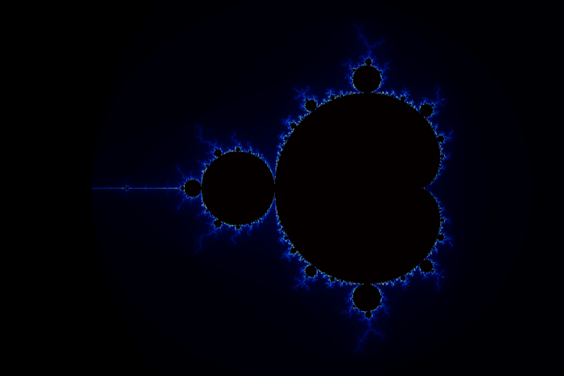
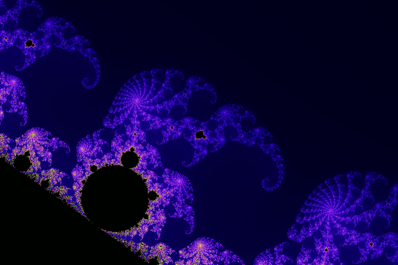
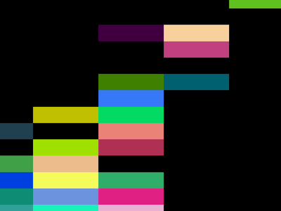
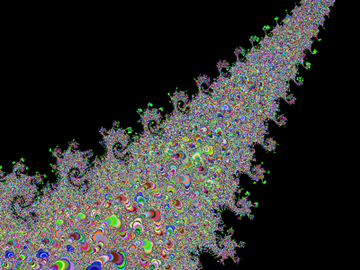

# Mandelbrot — SIMD and GPU

An interactive Mandelbrot (and Julia) set explorer whose purpose is to **compare the
same computation written for very different targets**: scalar C++, SIMD intrinsics
(SSE4, AVX2, AVX-512, ARM NEON), OpenMP multi-threading, fixed-point and quad
precision arithmetic, and GPUs through **Metal** (Apple) and **CUDA** (NVIDIA).

Every implementation ("engine") renders the exact same view, so you can switch
from one to another with a key press and see — or benchmark — the difference.

<p align="center">
  
  
  
  
</p>

---

## Contents

- [Features](#features)
- [Building](#building)
  - [Dependencies](#dependencies)
  - [Quick start](#quick-start)
  - [Build options](#build-options)
  - [Platform notes](#platform-notes)
    - [Ubuntu step by step](#ubuntu-step-by-step)
- [Usage](#usage)
  - [Command line options](#command-line-options)
  - [Keyboard and mouse](#keyboard-and-mouse)
  - [Examples](#examples)
- [Computation engines](#computation-engines)
  - [GPU engines: Metal and CUDA](#gpu-engines-metal-and-cuda)
- [Performance](#performance)
- [Project layout](#project-layout)
- [Adding a new engine](#adding-a-new-engine)
- [License](#license)

---

## Features

- **54 computation engines**: `float`, `double`, quad (`long double`), fixed-point
  (Q16.11, Q18.14, Q32.27), scalar or SIMD, single or multi-core, CPU or GPU.
  Only the engines supported by the build machine are compiled and listed.
- **GPU engines**: Metal (`SP_METAL`, `DF_METAL`) written in plain C++ with
  [metal-cpp](https://developer.apple.com/metal/cpp/), and CUDA (`SP_CUDA`, `DP_CUDA`).
- **Emulated double precision on Apple GPUs** (`DF_METAL`, "float-float"
  arithmetic): zoom ~10⁶ times deeper than single precision at GPU speed.
- **10 color palettes**, switchable at run time.
- **Portable GUI** based on GLFW + OpenGL (Linux, macOS, Windows), keyboard-layout
  aware (AZERTY/QWERTY…).
- **Headless rendering** to PNG / PPM / BMP — no external image library needed.
- **Benchmark mode** that times every available engine on the same 4K view.

---

## Building

### Dependencies

| Dependency | Required | Notes |
|---|---|---|
| C++17 compiler | yes | Clang, GCC or MSVC |
| CMake ≥ 3.16 | yes | |
| OpenMP | recommended | multi-core engines (`*_OMP`). macOS: `brew install libomp` |
| GLFW 3.3+ and OpenGL | for the GUI | **downloaded automatically** if not installed |
| Xcode command line tools | for Metal | macOS only, the Metal *toolchain* is **not** needed |
| CUDA Toolkit | for CUDA | auto-detected |

Installing the optional dependencies:

```bash
# macOS (Homebrew)
brew install cmake libomp glfw

# Fedora
sudo dnf install gcc-c++ cmake glfw-devel mesa-libGL-devel
```

For Debian / Ubuntu, see [Ubuntu step by step](#ubuntu-step-by-step) below.

If GLFW is not installed, CMake fetches and builds it (GLFW 3.4). On Linux this
requires the X11/Wayland development headers
(`libxrandr-dev libxinerama-dev libxcursor-dev libxi-dev libwayland-dev libxkbcommon-dev`).

### Quick start

```bash
git clone https://github.com/blegal/Mandelbrot-SIMD-and-GPU.git
cd Mandelbrot-SIMD-and-GPU
cmake -B build -DCMAKE_BUILD_TYPE=Release
cmake --build build -j
./build/mandelbrot
```

### Build options

Pass them to the configure step, e.g. `cmake -B build -DMANDELBROT_ENABLE_GUI=OFF`.

| Option | Default | Description |
|---|---|---|
| `MANDELBROT_ENABLE_GUI` | `ON` | GLFW + OpenGL window. `OFF` gives a headless binary (servers, CI) |
| `MANDELBROT_FETCH_GLFW` | `ON` | Download GLFW when it is not found on the system |
| `MANDELBROT_ENABLE_OPENMP` | `ON` | Multi-core engines (falls back to single core if OpenMP is missing) |
| `MANDELBROT_ENABLE_METAL` | `AUTO` | `AUTO` enables Metal on macOS with Clang and skips it elsewhere, `ON` makes it mandatory, `OFF` disables it |
| `MANDELBROT_ENABLE_CUDA` | `AUTO` | `AUTO` enables CUDA when `nvcc` is found, `ON` makes it mandatory, `OFF` disables it |
| `MANDELBROT_NATIVE` | `ON` | Tune for the build machine (`-march=native` on x86, `-mcpu=native` on ARM, `/arch:AVX2` with MSVC) |
| `CMAKE_CUDA_ARCHITECTURES` | `native` | GPU architectures for CUDA, e.g. `-DCMAKE_CUDA_ARCHITECTURES="86;87"` |

> **SIMD engines are selected at compile time.** With `MANDELBROT_NATIVE=ON` the
> binary uses every instruction set of the build machine (SSE4, AVX2, AVX-512,
> NEON) — and may therefore not run on an older CPU. Use `MANDELBROT_NATIVE=OFF`
> for a portable binary (scalar + OpenMP + GPU engines only).

### Platform notes

**macOS (Apple Silicon or Intel).** Apple Clang works out of the box; CMake finds
Homebrew's `libomp` automatically. The Metal kernels are embedded into the
executable at build time and compiled by the GPU driver on first use, so the
optional "Metal Toolchain" component of Xcode is not required. To build with
Homebrew's LLVM instead:

```bash
cmake -B build -DCMAKE_CXX_COMPILER=$(brew --prefix llvm)/bin/clang++
```

**Linux (x86-64 or ARM64).** Both GCC and Clang are supported. NEON engines are
used on ARM64 boards (Raspberry Pi, NVIDIA Jetson…). Metal is skipped
automatically.

**NVIDIA Jetson / CUDA machines.** Make sure `nvcc` is in the `PATH` (e.g.
`export PATH=/usr/local/cuda/bin:$PATH`); CUDA is then enabled automatically:

```bash
cmake -B build -DCMAKE_BUILD_TYPE=Release   # look for "CUDA engines : enabled"
cmake --build build -j
```

#### Ubuntu step by step

Package names are those of Ubuntu 22.04 and 24.04 (also valid on Debian 12).

**Without CUDA** (CPU engines + GUI):

```bash
sudo apt update
sudo apt install build-essential cmake git pkg-config \
                 libglfw3-dev libgl1-mesa-dev
```

GCC ships OpenMP (`libgomp`), nothing else is needed. If you build with Clang,
also install `clang libomp-dev`. For a headless build (server, CI, WSL without
display), the GLFW/OpenGL packages are not needed:

```bash
sudo apt install build-essential cmake git
cmake -B build -DCMAKE_BUILD_TYPE=Release -DMANDELBROT_ENABLE_GUI=OFF
cmake --build build -j
```

**With CUDA** (NVIDIA GPU): install the packages above, then the NVIDIA driver
and the CUDA Toolkit from NVIDIA's repository (replace `ubuntu2404` with
`ubuntu2204` on 22.04, and `x86_64` with `sbsa` on ARM64 servers):

```bash
# NVIDIA driver (skip if `nvidia-smi` already works), then reboot
sudo ubuntu-drivers install

# CUDA Toolkit
wget https://developer.download.nvidia.com/compute/cuda/repos/ubuntu2404/x86_64/cuda-keyring_1.1-1_all.deb
sudo dpkg -i cuda-keyring_1.1-1_all.deb
sudo apt update
sudo apt install cuda-toolkit

# make nvcc visible to CMake (add it to ~/.bashrc to keep it)
export PATH=/usr/local/cuda/bin:$PATH
```

The distribution package `sudo apt install nvidia-cuda-toolkit` also works and
is simpler, but it ships an older CUDA that may reject recent GCC versions
(`unsupported GNU version`); in that case pass an older host compiler, e.g.
`-DCMAKE_CUDA_HOST_COMPILER=g++-12`. On Jetson boards the toolkit comes with
JetPack: only the `export PATH=...` line is needed.

Then build as usual and check that CMake prints `CUDA engines : enabled`:

```bash
nvcc --version
cmake -B build -DCMAKE_BUILD_TYPE=Release -DMANDELBROT_ENABLE_CUDA=ON
cmake --build build -j
./build/mandelbrot -e SP_CUDA
```

**Windows.** Use Visual Studio 2022 (MSVC or clang-cl) or MSYS2/MinGW:

```bash
cmake -B build
cmake --build build --config Release
```

The FPGA engine (POSIX sockets) is not built on Windows.

---

## Usage

### Command line options

```
Usage: mandelbrot [options]

Display options:
  -w, --width  <px>          window / image width              (default: 1200)
  -h, --height <px>          window / image height             (default: 800)
  -i, --iters  <n>           maximum number of iterations      (default: 256, max: 32768)
  -e, --engine <name|id>     computation engine (see --list)   (default: first one)
  -c, --colormap <name|id>   color palette (see --list)        (default: first one)
  -x, --offset-x <real>      real part of the image center     (default: -0.7)
  -y, --offset-y <real>      imaginary part of the image center (default: 0.0)
  -z, --zoom <real>          size of one pixel in the complex plane (default: 0.004)
  -d, --dot                  draw a marker at the center of the image

Batch options:
  -o, --output <file>        render a single image (.png, .ppm, .bmp) and exit
  -b, --benchmark            benchmark every available engine and exit
  -n, --runs <n>             number of runs per engine in benchmark mode (default: 2)
  -l, --list                 list the available engines and color palettes
      --help                 display this help
```

Engines and palettes can be given by name (case insensitive) or by index, as
printed by `--list`.

In benchmark mode (`-b`) the default image is 3840×2160 on a fixed, demanding
view; `-w/-h` and `-x/-y/-z` override these defaults.

### Keyboard and mouse

| Input | Action |
|---|---|
| Mouse wheel | Zoom in / out, keeping the point under the cursor fixed |
| Left click | Center the view on the cursor |
| `A` / `Z` | Zoom in / zoom out |
| `O` / `P` | Halve / double the maximum number of iterations |
| `↑` / `↓` | Previous / next computation engine |
| `←` / `→` | Previous / next color palette |
| `R` | Reset the view |
| `C` | Toggle the central marker |
| `I` | Print the current coordinates **and the command line that reproduces the view** |
| `T` | Toggle printing the rendering time of each frame |
| `B` | Benchmark the current engine on 64 frames |
| `S` | Save a screenshot (`mandelbrot-YYYYMMDD-HHMMSS.png`) |
| `H` | Print the key bindings |
| `Esc` | Quit |

The window title shows the current engine, palette, number of iterations and
rendering time.

### Examples

```bash
# Explore with the Metal GPU engine and a colorful palette
./build/mandelbrot -e SP_METAL -c SMOOTH

# Full-HD, 1024 iterations, seahorse valley
./build/mandelbrot -w 1920 -h 1080 -i 1024 -x -0.7453 -y 0.1127 -z 1e-5 -c HSV_LOOP

# Headless rendering of a deep zoom (no window needed)
./build/mandelbrot -e DF_METAL -x -0.743643887037151 -y 0.131825904205330 \
                   -z 4e-10 -i 3000 -c SMOOTH_LOOP -o deep.png

# Benchmark every engine, 3 runs each
./build/mandelbrot -b -n 3

# Benchmark at a smaller resolution
./build/mandelbrot -b -w 1920 -h 1080
```

The screenshots of this page were produced with:

```bash
./build/mandelbrot -w 960 -h 640 -e DF_METAL -i 512  -c SMOOTH -o overview.png
./build/mandelbrot -w 960 -h 640 -e DF_METAL -i 1024 -c HSV_LOOP       -x -0.7453 -y 0.1127 -z 1.0e-5 -o seahorse-valley.png
./build/mandelbrot -w 960 -h 640 -e DF_METAL -i 1024 -c SMOOTH_SHIFTED -x 0.2925  -y 0.0149 -z 1.2e-5 -o elephant-valley.png
./build/mandelbrot -w 960 -h 640 -e DF_METAL -i 2048 -c ColorSetCandy  -x -1.7497219817 -y 0 -z 2e-9 -o minibrot.png
```

---

## Computation engines

Engine names follow the pattern `<format>_<target>[_OMP][_uN]`:

| Prefix | Arithmetic |
|---|---|
| `SP` | single precision (`float`) |
| `DP` | double precision (`double`) |
| `DF` | "float-float": double precision emulated with two `float` |
| `QP` | quad precision (`long double`, 80-bit on x86, 64-bit on ARM) |
| `FP_Qm_n` | fixed point (m-bit integers with n fractional bits) |
| `JU_*`, `DP_x86_J2`…`J10` | Julia sets (one constant *c* per engine) |
| `DP_x86_BS` | Burning Ship fractal |

| Suffix | Meaning |
|---|---|
| `_x86` or none | portable scalar C++ |
| `SSE4`, `AVX2`, `AVX512`, `NEON` | SIMD intrinsics (or [VCL](https://github.com/vectorclass/version2), `_vc`) |
| `_OMP` | multi-threaded with OpenMP |
| `_u2`, `_u4` | loop unrolled 2× / 4× to hide the latency of the FMA units |
| `METAL`, `CUDA` | GPU |

At startup the program instantiates every engine, discards the ones not supported
by the current machine (printed in red) and lists the available ones (in green).

### GPU engines: Metal and CUDA

**Metal** (`src/Convergence/metal/`) is written in C++ only, through Apple's
header-only *metal-cpp* bindings — no Objective-C:

- `MetalEngine` is the common base class: it owns the shared `MTL::Device` and
  command queue, compiles the kernel and manages a unified-memory output buffer
  (re-allocated when the image size changes).
- The kernel source `mandelbrot.metal` is embedded into the executable by CMake
  and compiled at run time with `MTL::Device::newLibrary(source, …)`.
- `SP_METAL` computes in `float` (fast-math enabled).
- `DF_METAL` computes in *float-float* arithmetic (Dekker / Knuth error-free
  transformations, ~48-bit mantissa). Apple GPUs have no hardware `double`; this
  engine keeps the image sharp at zoom levels where `float` is long gone, at
  ~3× the cost of `SP_METAL`. It is compiled with fast-math **disabled**, which
  the error-free transformations require.

<p align="center">
  
  
  <br/>
  <em>Same view (pixel size 4·10⁻¹⁰): <code>SP_METAL</code> (left) has run out of precision,
  <code>DF_METAL</code> (right) still renders the details.</em>
</p>

**CUDA** (`src/Convergence/cuda/`):

- `CudaEngine` is the common base class (device buffer management, error
  checking, detection of a CUDA device at startup).
- `mandelbrot_kernels.cu` holds a single templated kernel instantiated for
  `float` (`SP_CUDA`) and `double` (`DP_CUDA`), launched on 16×16 thread blocks.
- The engines themselves (`SP_cuda.cpp`, `DP_cuda.cpp`) are plain C++ files and
  only call the launchers declared in `mandelbrot_kernels.hpp`.

Note that consumer NVIDIA GPUs execute `double` 32 to 64 times slower than
`float`; `DP_CUDA` is mostly interesting on data-center GPUs.

---

## Performance

`./build/mandelbrot -b -n 3` — 3840×2160 pixels, 256 iterations, average time per
image. Apple M5 Max, Apple Clang, macOS:

| Engine | Format | SIMD | OpenMP | Time |
|---|---:|---:|---:|---:|
| SP | float | — | — | 2 803 ms |
| SP_OMP | float | — | ✓ | 429 ms |
| SP_NEON | float | NEON | — | 906 ms |
| SP_NEON_OMP | float | NEON | ✓ | 71.2 ms |
| **SP_METAL** | float | GPU | — | **4.6 ms** |
| **DF_METAL** | df64 | GPU | — | **13.9 ms** |
| DP_x86 | double | — | — | 3 022 ms |
| DP_x86_OMP | double | — | ✓ | 321 ms |
| DP_NEON | double | NEON | — | 1 664 ms |
| DP_NEON_OMP | double | NEON | ✓ | 143 ms |
| QP_OMP | quad | — | ✓ | 391 ms |
| FP_Q32_27_x86 | fixed | — | — | 3 163 ms |

Times include copying the iteration counts back to the host, but not the
colorization. Older measurements are kept in [`perfs/README.md`](perfs/README.md).

---

## Project layout

```
CMakeLists.txt
src/
├── main.cpp                    command line parsing, event loop
├── Mandelbrot.{hpp,cpp}        glue between engines, palettes and the image
├── Display/Window.{hpp,cpp}    GLFW + OpenGL window (optional)
├── Utils/Image.{hpp,cpp}       RGBA image + PNG/PPM/BMP writers (no dependency)
├── Color/                      color palettes (ColorMap and its subclasses)
│   └── library/                palette registry
├── Convergence/
│   ├── Convergence.{hpp,cpp}   base class of all engines
│   ├── library/                engine registry (ConvergenceLibrary)
│   ├── mandelbrot/<format>/<target>/{mono,multi}/   CPU / GPU engines
│   ├── julia/, others/         Julia sets, Burning Ship and other variants
│   ├── metal/                  MetalEngine, metal-cpp, mandelbrot.metal
│   └── cuda/                   CudaEngine, CUDA kernels
└── vectclass/                  Agner Fog's Vector Class Library (VCL)
docs/screenshots/               images of this README
```

The engines write the **iteration count of each pixel** into a `float` buffer;
the selected `ColorMap` then turns it into colors. This separation lets any
engine be combined with any palette, and keeps the GPU and SIMD code free of
any graphics dependency.

---

## Adding a new engine

1. Create a class deriving from `Convergence` (or `MetalEngine` / `CudaEngine`)
   and implement:

   ```cpp
   void updateImage(const long double zoom, const long double offsetX,
                    const long double offsetY, const int IMAGE_WIDTH,
                    const int IMAGE_HEIGHT, float* ptr) override;
   bool is_valid() override;   // false => engine removed at startup
   ```

   `(offsetX, offsetY)` is the center of the image and `zoom` the size of a
   pixel; write `IMAGE_WIDTH × IMAGE_HEIGHT` iteration counts into `ptr`.
2. Register it in `src/Convergence/library/ConvergenceLibrary.cpp`
   (`list.push_back(new MyEngine(nullptr, 255));`), guarded by the relevant
   `#if defined(__AVX2__)`, `_ENABLE_METAL_`, `_ENABLE_CUDA_`… macro.
3. Re-run CMake: `.cpp` files are picked up automatically, `.cu` files from
   `src/Convergence/cuda/`.

---

## License

Distributed under the terms of the GNU General Public License v2 — see
[`LICENSE`](LICENSE). The Vector Class Library (`src/vectclass`) and metal-cpp
(`src/Convergence/metal/Metal.hpp`) keep their own licenses (Apache 2.0).
